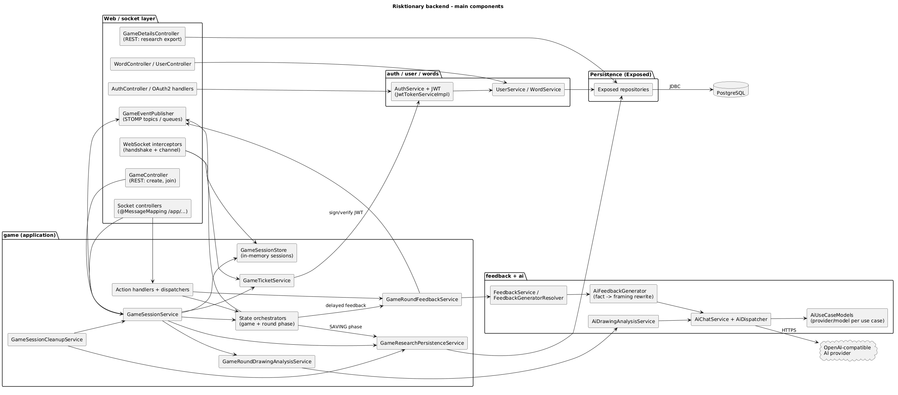
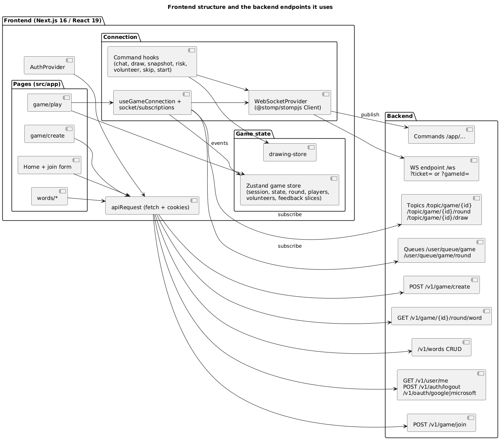
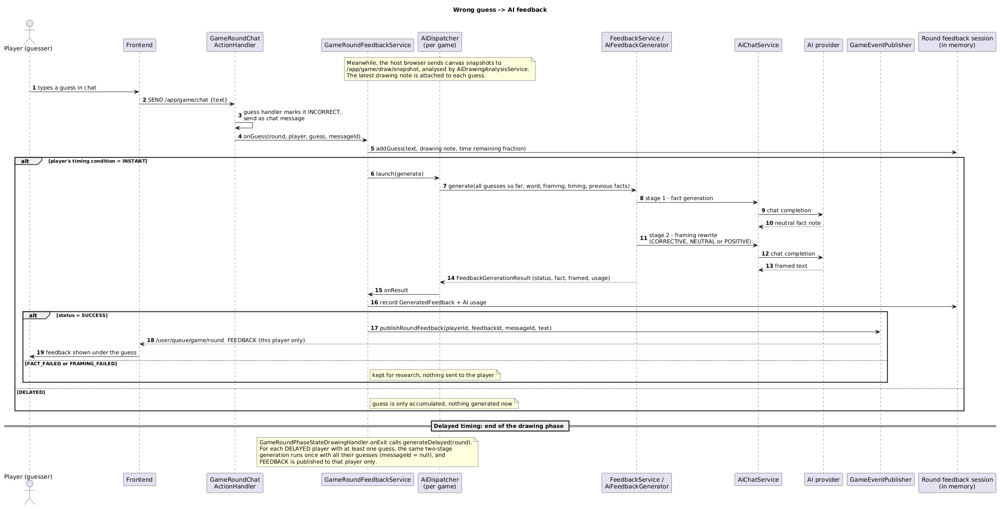

# Architecture

Diagrams: [backend components](diagrams/backend-components.puml) ([png](diagrams/backend-components.png)) ·
[frontend ↔ backend](diagrams/frontend-backend.puml) ([png](diagrams/frontend-backend.png)) ·
[feedback sequence](diagrams/feedback-sequence.puml) ([png](diagrams/feedback-sequence.png))



## 1. Big picture

| Part         | Tech                                                                                          |
|--------------|-----------------------------------------------------------------------------------------------|
| Backend      | Kotlin, Spring Boot 4.0.4, Exposed (SQL), Flyway, PostgreSQL, Spring AI 2.0 (OpenAI client), STOMP over WebSocket |
| Frontend     | Next.js 16, React 19, Zustand stores, `@stomp/stompjs`                                        |
| Reverse proxy| Nginx (repo root `nginx.conf`): `/api/ws/` and `/api/` → backend `:8080`, everything else → frontend `:3000` |

The backend packages are `ai`, `auth`, `feedback`, `game`, `user`, `words`, `shared`. Each follows a rough
`web / application / domain / infrastructure` layering (`game` also has `socket`).

**The key design point:** a running game lives **in memory** (`game/application/session/GameSession.kt`, held by
`GameSessionStore`). The database is a *research log* written to as the game goes (see §4); it is not read back to
resume a game. **Restarting the backend ends every game in progress.**

## 2. What uses REST and what uses WebSocket

REST is used for anything that happens before or outside a live game; the STOMP WebSocket carries everything during it.

### REST (all under `/v1`; through Nginx these are `/api/v1/...`)

Route constants live in `shared/web/support/Routes.kt`.

| Method & path                       | Auth                        | Purpose                                              | Code |
|-------------------------------------|-----------------------------|------------------------------------------------------|------|
| `GET /v1/oauth/{google\|microsoft}` | public                      | Start OAuth login (Spring Security `oauth2Login`)    | `shared/config/SecurityConfiguration.kt` |
| `GET /v1/oauth/{id}/callback`       | public                      | OAuth redirect URI                                   | `auth/infrastructure/security/OAuth2SuccessHandler.kt` |
| `POST /v1/auth/logout`              | cookie                      | Deletes the access-token cookie                      | `auth/web/controller/AuthController.kt` |
| `GET /v1/user/me`                   | cookie                      | Current user                                         | `user/web/controller/UserController.kt` |
| `POST /v1/game/create`              | cookie (host)               | Create a game session, returns host view             | `game/web/controller/GameController.kt` |
| `POST /v1/game/join`                | **public**                  | Join with `{code, displayName}`, returns a ticket    | same; see [game-join-tickets.md](game-join-tickets.md) |
| `GET /v1/game/{gameId}/round/word`  | **public**                  | Current word; only valid in the word-review phase    | same |
| `GET/POST/PUT/DELETE /v1/words[/{id}]` | cookie                   | Manage the word bank                                 | `words/web/controller/WordController.kt` |
| `GET /v1/game`                      | cookie + `RESEARCHER` role  | List persisted games                                 | `game/web/controller/GameDetailsController.kt` |
| `GET /v1/game/{gameId}/details`     | cookie + `RESEARCHER` role  | Everything persisted about a game                    | same |
| `GET /v1/game/{gameId}/drawings/{analysisId}` | cookie + `RESEARCHER` | Raw bytes of a drawing snapshot                  | same |

Everything not listed as public needs the access-token cookie (`anyRequest().authenticated()`).

### WebSocket / STOMP

Endpoint: `/ws` (`/api/ws` through Nginx), configured in `game/config/WebSocketConfiguration.kt`. A simple in-memory
broker handles `/topic` and `/queue`; the user prefix is `/user`; client commands go to `/app`. Heartbeats are 10 s
each way. Destination names are defined in `game/socket/support/WebSocketDestinations.kt` and
`WebSocketMappings.kt`.

Client → server (`/app/...`, handled by `game/socket/**/*SocketController.kt`):

| Destination               | Who          | Meaning |
|---------------------------|--------------|---------|
| `/app/player/ready`       | player, host | "I have subscribed; send me full state" |
| `/app/game/start`         | host         | Leave the lobby (starts countdown) |
| `/app/game/volunteer`, `/app/game/unvolunteer` | player | Volunteer to draw |
| `/app/game/select-drawer` | host         | Pick the drawer |
| `/app/game/skip-phase`    | host         | Skip a countdown (if enabled) |
| `/app/game/draw`          | drawer/host  | Stroke start/points/end, canvas clear → rebroadcast to `/topic/game/{id}/draw` |
| `/app/game/draw/snapshot` | host only    | Canvas image (data URL) for AI drawing analysis |
| `/app/game/chat`          | player       | Chat message, **also how guesses are submitted** |
| `/app/game/risk-rating`   | player       | Likelihood/severity rating |

Server → client:

| Destination                     | Audience         | Events (`type`) |
|---------------------------------|------------------|-----------------|
| `/topic/game/{id}`              | whole game       | `STATE`, `PLAYER_JOINED`, `PLAYER_LEFT`, `VOLUNTEERS_UPDATED` |
| `/topic/game/{id}/round`        | whole game       | round `STATE`, `PHASE_STATE`, `CHAT_MESSAGE`, `CORRECT_GUESSES_COUNT` |
| `/topic/game/{id}/draw`         | whole game       | drawing stroke events |
| `/user/queue/game`              | one connection   | `STATE`, `PLAYER_LIST_UPDATED`, `VOLUNTEERS_UPDATED` (initial sync) |
| `/user/queue/game/round`        | one connection   | `ASSIGNED_DRAWER`, `ASSIGNED_GUESSER`, `CORRECT_GUESS`, `RISK_RATINGS_UPDATED`, **`FEEDBACK`** |

All publishing goes through `game/socket/messages/GameEventPublisher.kt`. Frontend counterparts:
`frontend/src/features/game/socket/subscriptions/{game,round}.ts` (subscribe) and
`frontend/src/features/game/hooks/**/use-*-commands.ts` (send).



## 3. Authentication

Two completely separate mechanisms.

**Hosts (and word-bank editors / researchers) — Google or Microsoft OAuth.**
1. Browser goes to `/v1/oauth/google` or `/v1/oauth/microsoft` (`frontend/src/lib/api/api-routes.ts`). An optional
   `redirectUrl` query param is stored in a cookie by `OAuthRedirectCookieFilter`.
2. On success `OAuth2SuccessHandler` finds/creates the user (`auth/application/service/AuthService.kt`, matching by
   provider identity, then by e-mail) and sets an **HttpOnly JWT cookie** (`risktionary_at`, lifetime `jwt.access-lifetime`
   = 30 days, `Secure` in prod, `SameSite=Lax`) then redirects back to the frontend. The redirect target must start with `app.frontend-url`.
3. `JwtAuthenticationFilter` reads that cookie on every request. Sessions are stateless (no server session).
4. Roles live in table `risktionary_user_role`. The only role is `RESEARCHER` (`user/domain/model/UserRole.kt`), assigned
   directly in the database. There is no admin UI for it.

**Players — no account.** They send a game code and display name to `POST /v1/game/join` and get a short-lived signed
ticket that authorises one WebSocket connection. If the player happens to be signed in, the request carries the cookie and
they join as `GamePlayerIdentity.Authenticated`, otherwise as `Guest`. See [game-join-tickets.md](game-join-tickets.md).

**Host on WebSocket:** no ticket; the handshake uses the cookie (`?gameId=` query param) and checks the user is that game's host.

## 4. Game lifecycle and where state lives

### States and phases

Game state (`game/domain/model/GameState.kt`): `Lobby → Starting (lobby countdown) → InProgress → Completed`.

Each round (`game/application/session/round/GameRoundState.kt`) goes `SelectingDrawer → InProgress(phase, drawer) → Completed`.
Phases (`GameRoundPhase.kt`, order set by `GameRoundPhaseStateTransitionService.kt`):

```
Initialising → Drawing → DrawingReview → Ranking → RankingReview → WordReview → Saving → Scoring → Completed
```

| Phase           | What happens |
|-----------------|--------------|
| Initialising    | Placeholder created when the host selects a drawer; `GameRoundSelectDrawerActionHandler` immediately advances it to Drawing, so players never see it. Before this the round is in the `SelectingDrawer` state (players volunteer, host picks) |
| Drawing         | Drawer draws, others guess in chat. Ends on timer, host skip, or when every active guesser is correct. Delayed AI feedback is generated on exit |
| DrawingReview   | Answer revealed in chat |
| Ranking         | Players rate likelihood/severity |
| RankingReview   | Group results shown |
| WordReview      | Word description shown (`GET /v1/game/{id}/round/word` only works now) |
| **Saving**      | No timer, no input. Waits for outstanding AI calls, then writes the round to the DB; if the write throws, the round stays here |
| Scoring         | Round scoreboard |
| Completed       | Next round, or game → `Completed` |

Phase timers come from the `phaseDurationsMs` in the create-game request; a phase with no duration waits to be skipped.
`GameRoundPhaseStateOrchestrator` is the single place phases change: it stores the phase, publishes the event, calls the
per-phase handler (`game/application/handler/state/handler/`), and schedules the auto-advance via `GameSessionTaskService`.

### In memory vs persisted

| Data | Where | Notes |
|------|-------|-------|
| Sessions, players and their status, volunteers, scoreboard, current round, guesses, chat, ratings, drawing snapshots, feedback, AI usage | **Memory** (`GameSessionStore`, `GameSession`, `GameRoundSession`) | Lost on restart |
| Ticket | **Nowhere** — it is a self-contained signed JWT | See ticket doc |
| Users, OAuth links, roles, word bank | PostgreSQL | |
| Research log | PostgreSQL (`risktionary_game*` tables, Flyway `V3`–`V7`) | Below |

**What is written to the database, and when** (`game/application/service/GameResearchPersistenceService.kt`; synchronous, no retries, failures propagate):

| When | Written |
|------|---------|
| Host creates the game (`GameSessionService.createSession`) — *before* the session is registered | `risktionary_game` (code, host, config), phase durations, words, and a snapshot of the AI provider/model/temperature per use case (`risktionary_game_ai_use_case`) |
| Round enters **Saving** (`GameRoundPhaseStateSavingHandler`) | Single transaction: any new players (id and feedback condition only), the round, guesses, chat messages, risk ratings, drawing analyses (image bytes + AI note), feedback records, AI token usage |
| Round completes | `final_state` updated to COMPLETED |
| Game completes | `ended_at`, `end_reason = COMPLETED` |
| Stale session cleaned up | `end_reason = ABANDONED` (see below) |

Players are stored by random player id only; **display names and user ids of players are not persisted**. The host's user id is.

Stale sessions are removed by `GameSessionCleanupScheduler` every `app.game.session.cleanup.interval` (30 s): host never connected
within 60 s, host disconnected for over 5 min, or stuck in `Starting` for over 2 min.

## 5. The AI feedback pipeline

Purpose: research on how the *framing* and *timing* of AI feedback affect guessers. Class names below are under `feedback/`
and `game/application/`.



1. **Condition assignment.** When a player's WebSocket becomes active, `GameSessionFeedbackAssignmentService` gives them a
   `GamePlayerFeedbackAssignment` = framing (`CORRECTIVE`, `NEUTRAL`, `POSITIVE`) × timing (`INSTANT`, `DELAYED`) = 6 combinations,
   always picking randomly among the *least-used* combinations in that game (balanced). The assignment is kept for the game
   (`GameFeedbackSession`) and saved with the player.
2. **Drawing snapshot analysis.** The host's browser sends a canvas image (PNG, max 1024 px) every 10 s if the drawing changed
   (`frontend/.../use-canvas-snapshot.ts`) to `/app/game/draw/snapshot`. `GameSessionService.handleDrawingSnapshot` →
   `GameRoundDrawingAnalysisService` → `AiDrawingAnalysisService` (vision model, use case `image-analysis`). The result
   (`DrawingAnalysisResult`: a fact note, or a non-fact type/failed) is stored on the round's drawing session.
3. **Trigger.** A wrong guess arrives as a chat message (`GameRoundChatActionHandler`). It calls
   `GameRoundFeedbackService.onGuess`, which records the guess plus the latest drawing note and "fraction of drawing time remaining".
   Correct guesses and games with feedback mode `NONE` are skipped.
4. **Timing.**
   - `INSTANT`: generation starts immediately with *all of that player's guesses so far*.
   - `DELAYED`: guesses only accumulate; when the Drawing phase ends, `GameRoundPhaseStateDrawingHandler.onExit` calls `generateDelayed`, which runs once per delayed player who guessed at least once.
5. **Stage 1 — fact generation.** `AiFeedbackGenerator` (via `FeedbackService` → `FeedbackGeneratorResolver`) sends the guesses, correct
   word, synonyms, description and earlier facts to the `fact-generation` model. Output: a neutral "fact" note.
   Prompts: `src/main/resources/ai/prompts/feedback/fact-generation/`.
6. **Stage 2 — framing rewrite.** The fact (only) is rewritten by the `fact-framing-rewrite` model in the player's framing and
   timing style. Prompts: `.../feedback/framing-rewrite/`. A failure at either stage gives status `FACT_FAILED` / `FRAMING_FAILED`.
7. **Delivery to one player.** On `SUCCESS`, `GameEventPublisher.publishRoundFeedback` sends a `FEEDBACK` event through
   `convertAndSendToUser(playerId, "/queue/game/round")`, i.e. only to that player. Instant feedback carries the id of the chat
   message of the guess so the UI shows it as a reply; delayed feedback has no message id.
8. **Research store.** Every result (success or failure) is recorded on the round (`GeneratedFeedback`: conditions, status, fact text,
   framed text, the guess ids it used) and written at the Saving phase to `risktionary_game_round_feedback` +
   `risktionary_game_round_feedback_guess`. Token usage per call (with provider and model) goes to `risktionary_game_round_ai_usage`.
   Before saving, `awaitPending` waits up to `app.game.persistence.pending-ai-timeout` (10 s); later results are discarded and counted in `abandoned_ai_calls`.

AI calls run on a per-game `AiDispatcher` (`ai/infrastructure/dispatch/AiDispatcher.kt`, 2 threads). All providers are called with
the OpenAI chat-completions protocol (`AiUseCaseModelsConfiguration`), so OpenRouter, Gemini, OpenAI and Ollama share one code path.
See [deployment.md](deployment.md#6-configuring-the-ai-provider) for configuration.
