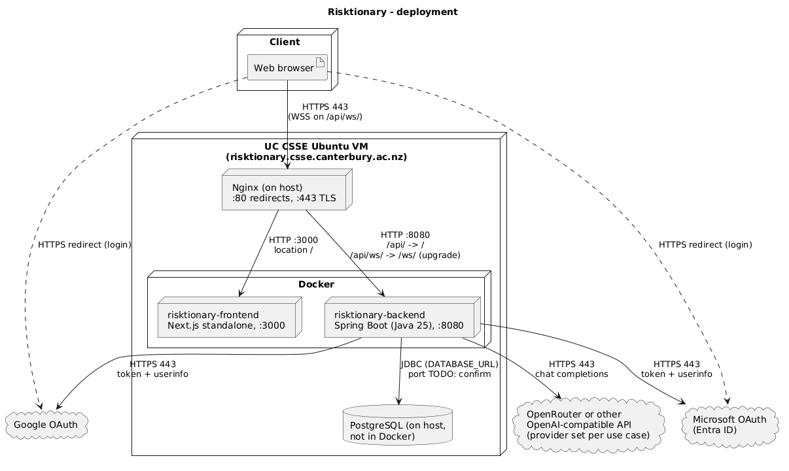

# Deployment and operations

Diagram: [deployment.puml](diagrams/deployment.puml) ([png](diagrams/deployment.png))



## 1. What runs where

| Component | Where | Evidence |
|-----------|-------|----------|
| Nginx | VM host, ports 80 (redirect to HTTPS) and 443 | `nginx.conf` (repo root, outside both repos) |
| Frontend | Docker container `risktionary-frontend`, port 3000 | `frontend/.gitlab-ci.yml` deploy job |
| Backend | Docker container `risktionary-backend`, port 8080 | `backend/.gitlab-ci.yml` deploy job |
| PostgreSQL | On the VM, **outside Docker** | Backend deploy job passes `DATABASE_URL`; no DB container is started. TODO: confirm host, port and DB name |
| AI | External OpenAI-compatible API (OpenRouter in production per the project brief) | `application.yaml` `app.ai.providers`. TODO: confirm which provider/models production uses |
| OAuth | Google and Microsoft Entra ID | `application.yaml` |

Nginx routing (`nginx.conf`): `http://` on 80 → 301 to HTTPS; on 443 `location /` → `localhost:3000`; `location /api/ws/` → `localhost:8080/ws/`
(WebSocket upgrade headers); `location /api/` → `localhost:8080/` with `X-Forwarded-Host` and `X-Forwarded-Prefix: /api`.
Server names: `csse-risk1.canterbury.ac.nz`, `risktionary.csse.canterbury.ac.nz`, `132.181.18.66`. Backend sets `server.forward-headers-strategy: framework`
so OAuth redirect URIs (`{baseUrl}/v1/oauth/<provider>/callback`) are built as `https://<host>/api/v1/oauth/...` — **register those exact URLs in the Google and Microsoft consoles**.

## 2. Prerequisites

- JDK 25 and Gradle (use the wrapper `./gradlew`) to run the backend outside Docker. Docker builds use `gradle:9-jdk25-alpine` and run on `eclipse-temurin:25-jre`.
- Node.js — the frontend image uses `node:25-alpine`; CI lints with Node 24.
- Docker (and Docker Compose for local database).
- PostgreSQL 16 (compose uses `postgres:16`; the production version is TODO: confirm).
- Google and Microsoft OAuth apps (client id/secret; Microsoft tenant id) and an API key for at least one AI provider.
- For production: a VM with Nginx, a TLS certificate (Certbot/Let's Encrypt, see §5), and a GitLab runner with `shell` and `docker` tags.

## 3. Environment variables

There are **no committed `.env` templates**: `*.env` is git-ignored (`backend/.gitignore`). The list below comes from `application*.yaml`,
`.gitlab-ci.yml`, and the *variable names* in the local `.local.env`/`.prod.env`/`.test.env` files (values were not read).

### Backend

| Variable | Purpose | Example (placeholder) | Required |
|----------|---------|-----------------------|----------|
| `SPRING_PROFILES_ACTIVE` | Profiles. Production: `prod,postgres`. Local dev: `local,postgres` or `h2` | `prod,postgres` | Yes (else no DB config) |
| `DATABASE_URL` | JDBC URL (`postgres` profile) | `jdbc:postgresql://<host>:5432/risktionary` | Yes with `postgres` |
| `DATABASE_USER` | DB user | `risktionary` | Yes with `postgres` |
| `DATABASE_PASSWORD` | DB password | *(secret)* | Yes with `postgres` |
| `JWT_SECRET` | HS256 key for login cookies **and game tickets**. Use a long random value | *(secret)* | **Always** |
| `GOOGLE_CLIENT_ID`, `GOOGLE_CLIENT_SECRET` | Google OAuth app | | **Always** |
| `MICROSOFT_CLIENT_ID`, `MICROSOFT_CLIENT_SECRET` | Microsoft OAuth app | | **Always** |
| `MICROSOFT_TENANT_ID` | Passed by CI and listed in env files, but **not referenced in `application.yaml`** (the Microsoft URIs use the `common` tenant). Harmless; TODO: confirm intent | | No |
| `FEEDBACK_AI_USE_CASE_IMAGE_ANALYSIS_MODEL` | Vision model for drawing screenshots | `<vendor/model>` | **Always** (no default; startup fails if unset) |
| `FEEDBACK_AI_USE_CASE_FACT_GENERATION_MODEL` | Model for stage 1 | | **Always** |
| `FEEDBACK_AI_USE_CASE_FACT_FRAMING_REWRITE_MODEL` | Model for stage 2 | | **Always** |
| `FEEDBACK_AI_USE_CASE_*_PROVIDER` (`IMAGE_ANALYSIS`, `FACT_GENERATION`, `FACT_FRAMING_REWRITE`) | Provider name per use case: `openai`, `gemini`, `openrouter`, `local` | `openrouter` | Optional, default `openai` |
| `FEEDBACK_AI_USE_CASE_*_TEMPERATURE` | Sampling temperature | | Optional: 0.2 / 0.3 / 0.4 |
| `OPENAI_API_KEY`, `OPENAI_BASE_URL` | `openai` provider (base URL default `https://api.openai.com/v1`) | | Key needed if any use case uses `openai` (the default) |
| `OPENROUTER_API_KEY` | `openrouter` provider (`https://openrouter.ai/api/v1`) | | Needed if used |
| `GEMINI_API_KEY` | `gemini` provider | | Needed if used |
| `LOCAL_AI_BASE_URL`, `LOCAL_AI_API_KEY` | `local` provider (default `http://localhost:11434/v1`, key default `ollama`) | | Optional |

Startup fails (by design) if a use case names an unknown provider or the provider has an empty key
(`feedback/config/AiUseCaseModelsConfiguration.kt`). `.test.env`, used by `docker-compose.yml`, lists no AI variables, so the compose backend
will fail to start until the three `*_MODEL` variables and a provider key are added (found by reading; not run).

Other settings in `application.yaml` (override with env vars via Spring relaxed binding, e.g. `APP_GAME_TICKET_LIFETIME=1h`): `app.frontend-url`
(prod profile hard-codes `https://risktionary.csse.canterbury.ac.nz`; this also drives CORS and WebSocket allowed origins), cookie settings, `jwt.access-lifetime`
(30d), `app.game.ticket.lifetime` (30m), `app.game.persistence.pending-ai-timeout` (10s), scoring, and session cleanup timers.

### Frontend

| Variable | Purpose | Default | When read |
|----------|---------|---------|-----------|
| `NEXT_PUBLIC_API_URL` | Base URL of the REST API | `http://localhost:8080` | **Build time** (baked into the JS) |
| `NEXT_PUBLIC_WS_URL` | WebSocket URL | `ws://localhost:8080/ws` | Build time |
| `NEXT_PUBLIC_SURVEY_URL` | Link text shown to players | empty | Build time |
| `SURVEY_REDIRECT_URL` | Where `/survey` redirects (server only) | empty | Run time (`-e`) |
| `NEXT_PUBLIC_PERSIST_GAME_SESSION` | Dockerfile `ARG` only; **no code in `frontend/src` reads it** | – | – |

Behind Nginx the API and WebSocket values should be the `/api` and `/api/ws` URLs on the public host (inferred from `nginx.conf`; the actual CI
variable values are TODO: confirm).

### Where production secrets live

The deploy job passes every value from GitLab CI variables (`$JWT_SECRET`, …) into `docker run -e`. They are presumably CI/CD variables in the
GitLab project settings. **TODO: confirm** (and who has access to them).

## 4. Running locally

### Backend, without Docker

```bash
cd backend
# create .local.env (git-ignored) containing the variables above, one KEY=VALUE per line
SPRING_PROFILES_ACTIVE=local,postgres ./gradlew bootRun     # app on http://localhost:8080
```

- `local` profile loads `.local.env` from the working directory and turns on debug logging and SQL logging.
- `postgres` needs a database (below). `h2` instead uses an in-memory H2 DB (`generate-ddl: true`; data is lost on exit; whether Flyway also runs against H2 is TODO: confirm).
- The backend README says `h2` needs no environment variables; that is not true of the current `application.yaml` — `JWT_SECRET`, the OAuth ids/secrets and
  the AI `*_MODEL` / key variables are still required.
- Register `http://localhost:8080/v1/oauth/google/callback` (and the Microsoft equivalent) as redirect URIs for local login.

### Database

```bash
cd backend
docker compose up -d database      # Postgres 16 on :5432, db/user/password "risktionary", data in ./db_data
```

Then `DATABASE_URL=jdbc:postgresql://localhost:5432/risktionary`, `DATABASE_USER=risktionary`, `DATABASE_PASSWORD=risktionary`.
`docker compose up --build` also builds and starts the backend container (reads `.test.env`; see AI note above).
The backend README says the `postgres` profile needs `DATABASE_NAME` and a MariaDB database; that is outdated, use `DATABASE_URL`.

Flyway runs automatically at startup on the `postgres` profile (`application-postgres.yml`: `baseline-on-migrate`, `validate-on-migrate`);
migrations are in `src/main/resources/db/migration` (`V1`…`V7`). Never edit an applied migration (validation will fail); add a new `V8__...sql`.

### Frontend

```bash
cd frontend
npm install
npm run dev          # http://localhost:3000, uses localhost:8080 defaults
```

Other scripts: `npm run lint`, `npm run typecheck`, `npm run build`, `npm run load-test` (`scripts/load-test/bot.mjs`).

## 5. Deploying to the VM

Normal path: **merge/push to `main`** — GitLab CI builds and redeploys both apps (§8). Manual equivalent for the backend, as the CI job does it:

```bash
# on the VM, in a checkout of the backend repo
docker build -t risktionary-backend:<tag> .
docker stop risktionary-backend || true && docker rm risktionary-backend || true
docker run -d --name risktionary-backend --restart unless-stopped -p 8080:8080 \
  -e SPRING_PROFILES_ACTIVE="prod,postgres" \
  -e DATABASE_URL=... -e DATABASE_USER=... -e DATABASE_PASSWORD=... -e JWT_SECRET=... \
  -e GOOGLE_CLIENT_ID=... -e GOOGLE_CLIENT_SECRET=... -e MICROSOFT_CLIENT_ID=... -e MICROSOFT_CLIENT_SECRET=... \
  -e OPENROUTER_API_KEY=... \
  -e FEEDBACK_AI_USE_CASE_IMAGE_ANALYSIS_PROVIDER=openrouter -e FEEDBACK_AI_USE_CASE_IMAGE_ANALYSIS_MODEL=... \
  -e FEEDBACK_AI_USE_CASE_FACT_GENERATION_PROVIDER=openrouter -e FEEDBACK_AI_USE_CASE_FACT_GENERATION_MODEL=... \
  -e FEEDBACK_AI_USE_CASE_FACT_FRAMING_REWRITE_PROVIDER=openrouter -e FEEDBACK_AI_USE_CASE_FACT_FRAMING_REWRITE_MODEL=... \
  risktionary-backend:<tag>
```

Frontend: build with the public URLs, then run on 3000:

```bash
docker build --build-arg NEXT_PUBLIC_API_URL=<https://host/api> --build-arg NEXT_PUBLIC_WS_URL=<wss://host/api/ws> \
             --build-arg NEXT_PUBLIC_SURVEY_URL=<url> -t risktionary-frontend:<tag> .
docker run -d --name risktionary-frontend --restart unless-stopped -p 3000:3000 -e SURVEY_REDIRECT_URL=<url> risktionary-frontend:<tag>
```

Notes:
- The container reaches PostgreSQL on the host, so `DATABASE_URL` must use an address the container can route to. The CI job uses default
  bridge networking with no `--add-host`, so the host's bridge IP or similar is needed. **TODO: confirm the production `DATABASE_URL`** and that Postgres accepts connections from Docker's subnet.
- `-p 8080:8080` publishes the backend on all interfaces; whether the VM firewall blocks outside access to 8080/3000 is **TODO: confirm**.
- The `.prod.env` file is only picked up if it sits in the container's working directory (`/app`); the Dockerfile does not copy it, so production relies on `-e` variables.
- Both CI jobs run `docker build` on the runner host itself (shell executor), which is the VM; images stay in the local Docker cache.

### Nginx and TLS

`nginx.conf` is a copy kept in the repo; **TODO: confirm** where it is installed on the VM (typically `/etc/nginx/sites-available/`) and how changes are applied. Its certificate lines
are marked "managed by Certbot" and point at `/etc/letsencrypt/live/csse-risk1.canterbury.ac.nz/`, so TLS is Let's Encrypt via Certbot. Renewal (cron/systemd timer) is **TODO: confirm**.
After editing: `sudo nginx -t && sudo systemctl reload nginx` (suggested).

### PostgreSQL setup (first time; suggested, not in repo)

```sql
CREATE USER risktionary WITH PASSWORD '<secret>';
CREATE DATABASE risktionary OWNER risktionary;
```

Flyway creates all tables on first start. Grant researchers access after they have logged in once (so a `risktionary_user` row exists):

```sql
INSERT INTO risktionary_user_role (user_id, user_role)
SELECT id, 'RESEARCHER' FROM risktionary_user WHERE email = '<their email>';
```

## 6. Configuring the AI provider

Three independent **use cases** — `image-analysis`, `fact-generation`, `fact-framing-rewrite` — each choose a provider, a model and a temperature
(`app.feedback.ai.use-cases` in `application.yaml`, set through the `FEEDBACK_AI_USE_CASE_*` variables). Providers are listed under `app.ai.providers`:

| Provider name | Base URL | Key variable |
|---------------|----------|--------------|
| `openai` | `https://api.openai.com/v1` or `OPENAI_BASE_URL` | `OPENAI_API_KEY` |
| `openrouter` | `https://openrouter.ai/api/v1` | `OPENROUTER_API_KEY` |
| `gemini` | `https://generativelanguage.googleapis.com/v1beta/openai/` | `GEMINI_API_KEY` |
| `local` | `http://localhost:11434/v1` or `LOCAL_AI_BASE_URL` | `LOCAL_AI_API_KEY` |

To use OpenRouter: set `OPENROUTER_API_KEY`, set the three `_PROVIDER` variables to `openrouter`, and set the three `_MODEL` variables to OpenRouter model ids.
The image-analysis model must accept images. Any other OpenAI-compatible endpoint can be added as a new entry under `app.ai.providers`
(see backend `README.md`, "Configuring AI"). Changing provider/model needs a **restart**. Each game records the provider/model/temperature it ran with
(`risktionary_game_ai_use_case`), so changing it mid-study is traceable.

**Turning AI feedback on or off:** there is no switch. `GameSessionService.createSession` hard-codes `FeedbackGenerationMode.AI`, the `NONE` mode exists in the
enum but nothing sets it, and the frontend's feedback options are not read by the backend (see [architecture.md](architecture.md#6-known-gaps-in-the-code-worth-knowing-before-you-change-things)).
You cannot run the backend without AI settings either. To disable feedback you would have to change `createSession` to `FeedbackGenerationMode.NONE` and redeploy.
Also note a failing provider does not break a game: failures are recorded as `FACT_FAILED` / `FRAMING_FAILED` and no feedback is shown.

## 7. Operating it

Names below are from the CI deploy jobs.

| Task | Command |
|------|---------|
| Logs (follow) | `docker logs -f --tail 200 risktionary-backend` (and `risktionary-frontend`) |
| Status / restart | `docker ps`, `docker restart risktionary-backend` — **a restart ends all live games** |
| Nginx logs | `/var/log/nginx/access.log`, `error.log` (default locations; TODO: confirm) |
| Update | Push to `main` and let CI redeploy, or rebuild + re-run as in §5 |
| Roll back | Backend images are tagged `risktionary-backend:<CI_COMMIT_SHORT_SHA>` and (for `main`) are not deleted by CI. `docker images risktionary-backend`, then stop/remove the container and `docker run` the older tag with the same `-e` flags. Alternatively revert the commit on `main` and let CI redeploy. Frontend: same with `risktionary-frontend` |
| DB schema rollback | Not supported: Flyway migrations are forward-only here. Restore a backup instead |
| Logging level | Prod profile sets `nz.coreyh.risktionary: debug` |

Warning for rollbacks: only roll the backend back to a version that is compatible with the current schema (Flyway `validate-on-migrate` refuses to start
an older jar if the DB already contains a newer migration it does not know about).

### Backing up the database (suggested; no backup job is in the repo)

```bash
pg_dump -U risktionary -h <db host> -Fc risktionary > risktionary_$(date +%F).dump     # backup
pg_restore -U risktionary -h <db host> -d risktionary --clean risktionary_YYYY-MM-DD.dump  # restore
```

Schedule it (cron) and copy dumps off the VM. **TODO: confirm** whether the CSSE VM already has backups. The research tables hold drawing images (`BYTEA`), so the DB can grow large.

## 8. CI/CD, tests, Dependabot

### Backend

| File | What it does |
|------|--------------|
| `backend/.gitlab-ci.yml` | `test` (docker runner, `gradle:9.5-jdk25-alpine`, `gradle test`, JUnit + JaCoCo coverage report) → `build` (shell runner, `docker build -t risktionary-backend:$CI_COMMIT_SHORT_SHA`; image removed again if not `main`) → `deploy` (`main` only: stop/remove old container, `docker run` the new image with all variables). The build job passes `--build-arg SPRING_PROFILES_ACTIVE/DATABASE_URL` but the Dockerfile declares no such `ARG`, so they are ignored |
| `backend/.github/workflows/ci.yml` | On every push: `test` (JDK 25 Temurin, `./gradlew test`, uploads reports); `build` (docker build only, not pushed); on a `v*` tag: `validate-tag` (`scripts/validate-tag.sh`, semver such as `v1.2.3`) then `publish` to `ghcr.io/<owner>/risktionary-backend:<version>` and `:latest`. **GitHub does not deploy to the VM** |
| `backend/.github/dependabot.yml` | Weekly updates for Gradle, Docker and GitHub Actions |

The repo has two remotes: `origin` (UC GitLab, `eng-git.canterbury.ac.nz/chi125/risktionary-backend`) is what deploys; `github` mirrors it.

Tests: `./gradlew test` (JUnit 5 + MockK + Kotest; integration tests use `@ActiveProfiles("test","h2")` and mocked AI models in `src/test/.../TestAiConfiguration.kt`, so no keys or network are needed). Coverage report: `build/reports/jacoco/test/`.

### Frontend

| File | What it does |
|------|--------------|
| `frontend/.gitlab-ci.yml` | `lint` (`npm ci && npm run lint`) → `build` (docker build with `NEXT_PUBLIC_*` args) → `deploy` (`main` only; `docker run -p 3000:3000 -e SURVEY_REDIRECT_URL`). Quirks: the build step passes `SURVEY_REDIRECT_URL=SURVEY_REDIRECT_URL` (missing `$`, so the literal word, harmless because the value is read at run time) and does not pass `NEXT_PUBLIC_PERSIST_GAME_SESSION` |
| `frontend/.github/workflows/ci.yml` | lint → docker build (uses repository `vars`); `v*` tag → publish to GHCR. Does not deploy |
| `frontend/.github/dependabot.yml` | Weekly npm (grouped: Next/React, TipTap, Tailwind, ESLint), Docker, GitHub Actions |

There are no frontend tests (`npm run lint` / `typecheck` only).

## 9. Exporting game and research data

What is recorded is described in [architecture.md](architecture.md#in-memory-vs-persisted). Two ways to get it out:

**A. REST (needs the `RESEARCHER` role, see §5).** Log in via the website so you have the `risktionary_at` cookie, then:
- `GET /api/v1/game` — summaries of all persisted games, newest first.
- `GET /api/v1/game/{gameId}/details` — everything for one game (config, players with conditions, rounds, guesses, chat, ratings, drawing analyses, feedback, AI usage).
- `GET /api/v1/game/{gameId}/drawings/{analysisId}` — the image bytes of one snapshot.
These are plain JSON endpoints, so a script can reuse the cookie (e.g. copied from the browser). OpenAPI docs come from springdoc; its UI path is not configured explicitly, so the default is probably `/swagger-ui.html` (TODO: confirm; note it also requires login).

**B. Straight from PostgreSQL** (best for bulk analysis). Tables (all prefixed `risktionary_`): `game`, `game_phase_duration`, `game_word`, `game_player`, `game_round`,
`game_round_guess`, `game_round_chat_message`, `game_round_risk_rating`, `game_round_drawing_analysis`, `game_round_feedback`, `game_round_feedback_guess`,
`game_round_ai_usage`, `game_ai_use_case`. Example (suggested):

```bash
psql -h <host> -U risktionary risktionary -c "\copy (SELECT * FROM risktionary_game_round_feedback) TO 'feedback.csv' CSV HEADER"
```

Notes for analysis: players are identified only by a random id per game (no names), the feedback conditions are on `risktionary_game_player`
(`feedback_framing_condition`, `feedback_timing_condition`), `risktionary_game.end_reason` is `COMPLETED` or `ABANDONED`, and a non-zero `abandoned_ai_calls` on a round means some
AI calls were given up on at save time (column added in `V4`; see `V3`–`V7` for the rest).
