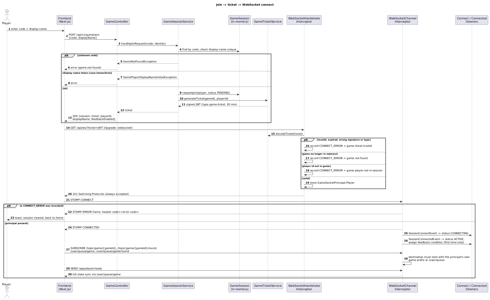

# Joining a game: tickets and the WebSocket

Players have no account. They prove they may connect to a game with a **ticket** returned by the join request.

Diagram: [join-ticket-sequence.puml](diagrams/join-ticket-sequence.puml) ([png](diagrams/join-ticket-sequence.png))



## 1. Step 1 — `POST /v1/game/join`

Public endpoint (`shared/config/SecurityConfiguration.kt`). Through Nginx: `POST https://<host>/api/v1/game/join`.
Handler: `game/web/controller/GameController.kt` → `GameSessionService.handleJoinRequest`.

Request (`game/web/dto/request/JoinGameRequest.kt`):

```json
{ "code": "123456", "displayName": "Sam" }
```

- `code` is a 6-digit numeric game code (`GameSessionService.CODE_LENGTH`/`CODE_CHARACTERS`), looked up in the in-memory `GameSessionStore`.
- `displayName` is trimmed. If the request carries a valid access-token cookie the player joins as `Authenticated`, otherwise `Guest`.
  The frontend sends `credentials: "include"` (`frontend/src/features/game/hooks/lobby/use-join-game.ts`).

Response `200` (`game/web/dto/response/JoinGameResponse.kt`):

```json
{
  "session": { "...": "game view for the player" },
  "ticket": "<signed JWT>",
  "playerId": "<uuid>",
  "displayName": "Sam",
  "feedbackEnabled": true
}
```

Failures: unknown code → `GameNotFoundException`; a display name already used in the game (case-insensitive) →
`GamePlayerDisplayNameInUseException`. A blank display name is **not** rejected in the controller. (The OpenAPI text says a missing name
gives 400; the code does not check.)

What the server does on success: creates a `GamePlayer` with a fresh random `GamePlayerId`, adds it to the `GameSession` with status
`PENDING` (`GameSession.requestJoin`) and issues the ticket. **Joining happens here, before any WebSocket exists**: a player who never
connects still occupies a name in the game.

## 2. The ticket

Created by `game/application/service/GameTicketService.kt`, signed by `shared/infrastructure/service/JwtTokenServiceImpl.kt`.

| Property      | Value |
|---------------|-------|
| Format        | JWT, HS256, signed with the same `JWT_SECRET` as login cookies |
| `sub`         | the player id |
| `game` claim  | the game id |
| `type` claim  | `game-ticket`. `decodeToken` rejects any token whose `type` differs, so a login cookie cannot be used as a ticket and vice versa |
| `iat` / `exp` | issue time / issue time + `app.game.ticket.lifetime` (**30 minutes**, `application.yaml`) |
| Storage       | **None.** The ticket is stateless; the server keeps no list of issued tickets |
| Scope         | one player in one game; does not carry a role |

Consequences — read these before assuming a "one-time ticket":

- **It is not single use.** `WebSocketHandshakeInterceptor`'s Javadoc says "one-time game ticket" but nothing records use. The same ticket can open
  several WebSocket connections until it expires. Nothing revokes a ticket either (except that the game ceasing to exist makes it useless).
- Validation is signature + expiry + `type` claim + "does this game exist in memory" + "is this player in that game".
  Anyone holding the ticket *is* that player, so it must stay secret (it is sent in the URL query string — see §5).
- Changing `JWT_SECRET` invalidates all outstanding tickets and login cookies.

## 3. Step 2 — connect the WebSocket

The frontend (`frontend/src/features/game/hooks/connection/use-game-connection.ts`) opens
`NEXT_PUBLIC_WS_URL + "?ticket=" + ticket` (production: `wss://<host>/api/ws/?ticket=…`; Nginx forwards `/api/ws/` to the backend `/ws/`).

Validation happens in two places:

1. **HTTP upgrade** — `game/socket/interceptor/WebSocketHandshakeInterceptor.kt`. If a `ticket` query param is present it decodes it, then
   checks the game exists, then checks the player is in that game. (If there is no ticket but a `gameId` param, it treats the request as a host
   connection and uses the login cookie instead.)
2. **STOMP CONNECT** — `WebSocketChannelInterceptor.kt`. Browsers cannot read the status/body of a failed WebSocket upgrade, so a failed
   check does *not* reject the upgrade. The error code is stashed on the session and the **CONNECT frame is answered with a STOMP ERROR**
   frame whose `code` header is one of:

| `code` header                   | Cause |
|---------------------------------|-------|
| `game.ticket-invalid`           | Bad signature, expired, wrong `type`, malformed |
| `game.not-found`                | Game no longer in memory (ended, cleaned up, backend restarted) |
| `game.player-not-in-session`    | Ticket is valid but that player id is not in the game |
| `auth.unauthenticated`          | No principal (and host: no valid cookie) |
| `generic.bad-request` (frontend default) | Missing/invalid params |

   `WebSocketStompErrorHandler` builds the frame. The frontend maps these codes to toasts (`ERROR_MESSAGES` in `use-game-connection.ts`),
   clears the saved session for any code other than `client.connection-failed`, and sends the user home.

After CONNECT, **SUBSCRIBE** is restricted: a player may only subscribe to destinations starting with `/topic/game/{their gameId}` or
`/user/queue`. This stops a player listening to another game even if they know its id.

Player status along the way (`GamePlayerStatus`): `PENDING` (after join) → `CONNECTING` (STOMP CONNECT event,
`WebSocketConnectListener`) → `ACTIVE` (STOMP CONNECTED event, `WebSocketConnectedListener`; feedback condition assigned here) →
`DISCONNECTED` (`WebSocketDisconnectListener`).

Finally the client subscribes and sends `/app/player/ready`; the server replies with full state (`GameSessionService.handleReady`).

## 4. Reconnecting

- **Same page, dropped socket.** `@stomp/stompjs` reconnects automatically (1 s, exponential, max 10 s) to the *same URL* — i.e. with the *same
  ticket*. After 5 failed attempts the frontend gives up (`client.connection-failed`). A STOMP ERROR frame is treated as fatal and is not retried.
- **Page refresh.** The game session (including the ticket and player id) is persisted in the browser's `sessionStorage`
  (`frontend/src/features/game/stores/game-store.ts`; per tab), so a refresh reconnects with the stored ticket and, when
  it succeeds, `handleReady` re-sends full state. The player keeps their id, score and feedback assignment because the `GamePlayerSession`
  stays in memory with status `DISCONNECTED`.
- **Ticket expired (>30 min since join).** The reconnect gets `game.ticket-invalid`; the UI says "Your join link has expired. Please rejoin the game."
  Rejoining calls `/v1/game/join` again, which creates a **new player** (new id, no score or history), and the old name is still taken by the
  old player unless it has been removed, so the player may need a different display name. There is no refresh-ticket endpoint.
  (Lifetime is a long-ish 30 min precisely so a normal game outlasts the ticket; a game longer than that is a risk for players who drop late.)
- **Backend restart.** All sessions vanish, so reconnects fail with `game.not-found`.
- Leaving a game does not remove the player from the session; they stay as `DISCONNECTED` (`handleDisconnected`).

## 5. Security reasoning and limits

Why this design: players are anonymous and many (classroom use), so there is no login to lean on. A signed, expiring, game-scoped token lets
the backend authenticate the WebSocket without a database lookup, and the HTTP join step is where the game code, name uniqueness and
(optional) account identity are decided.

What it protects: the signature stops forged ticket/player ids; the `game` claim plus the subscribe check keeps a player inside their own
game; the `type` claim stops cross-use with login tokens; short expiry limits replay.

Things a maintainer should know (observations from the code, not recommendations already agreed with the team):
- The ticket is in the WebSocket URL query string, so it can appear in Nginx access logs and proxies. `nginx.conf` does not change the default log format (TODO: confirm VM logging settings).
- Not single-use and not revocable (above).
- The game code is only 6 digits and the join endpoint has no rate limit in the code, so codes are guessable while a game is open.
- The WebSocket allowed-origin pattern is `app.frontend-url` (`https://risktionary.csse.canterbury.ac.nz` in prod). Loading the site through the other
  Nginx server names (`csse-risk1.canterbury.ac.nz`, the IP) would be refused by the origin and CORS checks.
- The host connection needs no ticket, only the cookie plus being the game's host.
